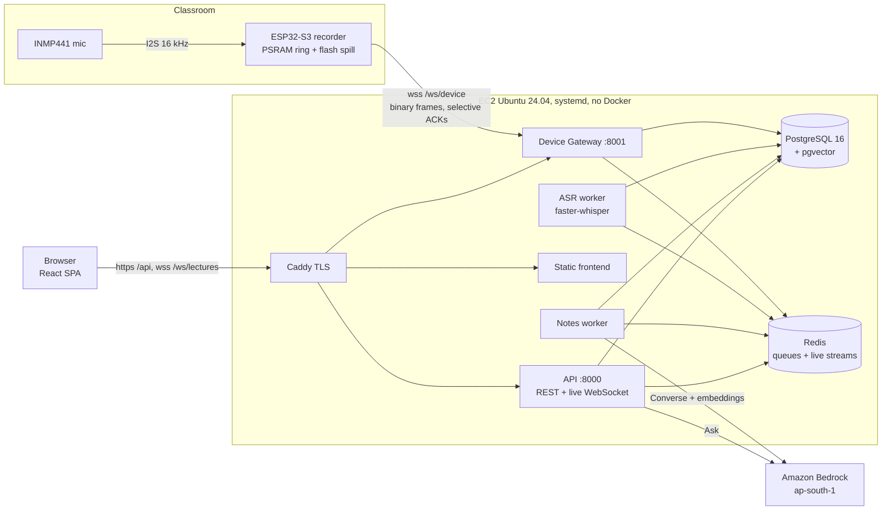

# IoT-Based Smart Classroom Lecture Capture and Real-Time AI Speech-to-Text System

The system has three parts:
- An ESP32-S3 recorder on the lecturer's desk streams classroom audio to a server.
- The server transcribes the audio live in English, Hindi and Telugu, and shows it to students in the browser within seconds.
- After the lecture, the server generates notes, a summary, key terms and practice questions with Amazon Bedrock. Students can search across lectures and ask questions about a lecture.

If the network drops, no audio is lost: the device buffers in PSRAM, spills to flash, and resends when the connection returns. The transcript then fills the gap in place.

## Architecture



**Data flow:**
1. The device sends 0.5 s audio chunks.
2. The gateway stores each chunk once (idempotent on `lecture_id, seq`), ACKs it, and queues the lecture for ASR.
3. The ASR worker decodes sliding windows with local agreement and publishes `transcript.partial` and `transcript.final` events to the lecture's Redis Stream.
4. The API relays the stream to browsers, which resume from their last `seq` after a reconnect.
5. After Stop, the ASR worker finalises the transcript, and the notes worker generates study material.

PostgreSQL is the source of truth; Redis holds only transient state.

## Repository

| Folder | Contents | Docs |
|---|---|---|
| `firmware/` | ESP-IDF projects: mic validation (`mic_test`), recorder, shared C core (`lc_core`) | [firmware/README.md](firmware/README.md) |
| `contracts/` | Device and browser protocol, JSON Schemas, `openapi.json`, ADPCM test vectors | [contracts/PROTOCOL.md](contracts/PROTOCOL.md) |
| `backend/` | FastAPI gateway and API, ASR worker, notes worker, device simulator, tools | [backend/README.md](backend/README.md) |
| `frontend/` | React 19 + TypeScript SPA: live view, library, study tabs, search, devices, admin | `frontend/package.json` scripts |
| `infra/` | EC2 setup and deploy scripts, systemd units, Caddyfile, backups | [infra/README.md](infra/README.md) |
| `eval/` | WER/CER benchmark, latency report, network-recovery report | [eval/README.md](eval/README.md) |
| `docs/` | Design review, decisions D1–D14, contract assumptions, progress; project report, PPT outline, UML, circuit, user manual, demo script in `docs/project/` | [docs/DECISIONS.md](docs/DECISIONS.md), [docs/project/REPORT.md](docs/project/REPORT.md) |

## Try it without hardware

**The frontend alone, with mock data** (no backend needed):

```bash
cd frontend
npm ci
npm run dev:mock          # http://localhost:5173
```

Demo logins (mock mode only; from `frontend/src/test/fixtures/people.ts`):

| Role | Email | Password |
|---|---|---|
| Lecturer | `priya.raghavan@college.example` | `lecturer-demo` |
| Student | `arjun.kumar@college.example` | `student-demo` |
| Admin | `meena.iyer@college.example` | `admin-demo` |

**The full stack locally** needs Python 3.11+, Node 22+, PostgreSQL 16 with pgvector, and Redis (Memurai or WSL on Windows):

```bash
# 1. Backend: see backend/README.md for details
cd backend
python -m venv .venv && . .venv/bin/activate            # Windows: .venv\Scripts\activate
pip install -e ".[dev,eval,asr]"
cp .env.example .env                                      # set DATABASE_URL, REDIS_URL, BEDROCK_LLM_MODEL_ID
alembic upgrade head
python -m tools.seed --admin-email you@college.edu --demo # prints a demo device id and token
uvicorn app.api.main:app --port 8000 &
uvicorn app.gateway.main:app --port 8001 &
python -m worker.asr.main &
python -m worker.notes.main &

# 2. Frontend (proxies /api and /ws to :8000)
cd ../frontend && npm ci && npm run dev

# 3. A simulated device streaming a WAV, with a 30 s outage at 60 s
cd ../backend
python -m tools.device_simulator --url ws://127.0.0.1:8001/ws/device \
  --device-id <id> --token <token> --wav lecture.wav --outage 60:30
```

In development, the gateway's `/ws/device` is reached on port 8001 directly. In production, Caddy routes it.

AWS credentials for Bedrock come from the standard AWS chain (`aws login`, a profile, or the EC2 instance role). Without them, transcripts still work: the AI artifacts are marked `failed`, and Ask returns `503`.

## Configuration

All backend settings are environment variables, documented in [backend/.env.example](backend/.env.example) (development) and [infra/env/backend.env.example](infra/env/backend.env.example) (production). The ones you must set:

| Variable | Purpose |
|---|---|
| `DATABASE_URL` | `postgresql+asyncpg://…` |
| `REDIS_URL` | `redis://127.0.0.1:6379/0` |
| `BEDROCK_LLM_MODEL_ID` | A Bedrock model or inference profile enabled in your account (D9) |
| `COOKIE_SECURE` | `true` behind HTTPS; `false` only for plain-http development |
| `ASR_MODEL` | faster-whisper size; choose it with `eval/asr_benchmark.py` (D11) |
| `S3_BUCKET` | Optional: store audio in S3 instead of `AUDIO_DIR` |

The frontend needs no configuration when served from the same host. `VITE_API_BASE_URL` and `VITE_WS_BASE_URL` override the defaults (`/api` and same-origin `wss://`).

## Protocols

Both protocols are specified in [contracts/PROTOCOL.md](contracts/PROTOCOL.md):

- **Device ↔ gateway:** binary audio frames with a 26-byte header (magic, version, codec PCM16/IMA-ADPCM, seq, sample offset, capture time, payload length), plus JSON control messages. These are `hello`, `start`/`resume`/`stop`, `status`, and `ack{seq, ranges}`.
  - Selective ACKs let the device send live audio first and backlog in spare bandwidth (D1).
  - The session id is generated on the device, so a lecture can start offline (D3).
- **Browser ↔ API:** one WebSocket per lecture.
  - Events: `transcript.partial`, `transcript.final`, `transcript.gap`, `transcript.backfill`, `key_terms.update`, `notes.ready`, `device.status` and `lecture.status`.
  - Every event has a `seq` and `server_ts`. The client resumes with `last_seq` and measures latency with `ping`/`pong` and `render.ack`.
- **REST:** `contracts/openapi.json`, exported from FastAPI. The frontend's types are generated from it (`npm run api:generate`). Open questions and how they were resolved are in [docs/CONTRACT_ASSUMPTIONS.md](docs/CONTRACT_ASSUMPTIONS.md).

## Tests

| Part | Command | What runs |
|---|---|---|
| Backend | `cd backend && python -m pytest -q && ruff check . && mypy app worker tools` | 56 tests on an embedded PostgreSQL + pgvector: real WebSockets, the simulator with an outage, the ASR pipeline with a deterministic fake model, and notes with a scripted LLM |
| Frontend | `cd frontend && npm run check && npm run build && npm run size` | Typecheck, lint, CSS token lint, format, 102 vitest tests (component tests run against MSW and a fake live socket); the initial-JS budget (≤ 200 KB gzip) |
| End-to-end | `cd frontend && npm run e2e` | 34 Playwright tests on the mock build: prepare → live, outage gap → backfill, socket drop → resume with no duplicates, search → timestamp, deep-link scrolling, quiz, export, and axe WCAG 2.1 A/AA on every route for every role. Set `PW_CHANNEL=chrome` to use an installed Chrome instead of Playwright's bundled browser |
| Eval | `backend/.venv/bin/python -m pytest eval` | 38 tests: Indic-safe normalisation, WER/CER, percentiles, latency pairing, recovery checks |
| Firmware | `firmware/lc_core/test_host` (CMake) | Host unit tests for framing, ADPCM, ACK ranges, ring buffer, flash log, backoff |

## Deployment

Use one Ubuntu 24.04 EC2 instance, with no Docker (D12):

```bash
sudo SITE_ADDRESS=lecture.college.edu bash infra/ec2/setup.sh     # once
sudo bash infra/ec2/deploy.sh                                      # each release
```

[infra/README.md](infra/README.md) covers instance sizing, IAM, backups, operations and troubleshooting.

## Known limitations

- **Firmware has never been compiled.** No ESP-IDF toolchain or C compiler was available where it was written, and that includes the `lc_core` host tests. Expect to fix build errors on the first build. The ADPCM codec is cross-checked against Python test vectors.
- **faster-whisper and Bedrock are not exercised by the automated tests**, which use a fake transcriber and a scripted LLM. Accuracy and speed must be measured on real recordings with `eval/asr_benchmark.py` before choosing `ASR_MODEL` and the instance size.
- **Practice-question answers are sent to students** (`correct_index`). That is fine for self-revision, but not for graded tests.
- **There is no automated quality benchmark for AI notes or Ask**; review generated material by hand per language.
- **Clock skew:** cross-device latency figures (`capture→rendered`) include the offset between the device and browser clocks.
- **One gateway process:** device connection state is in memory, so the gateway does not scale horizontally as written. One process handles many classrooms; the CPU limit is ASR.
