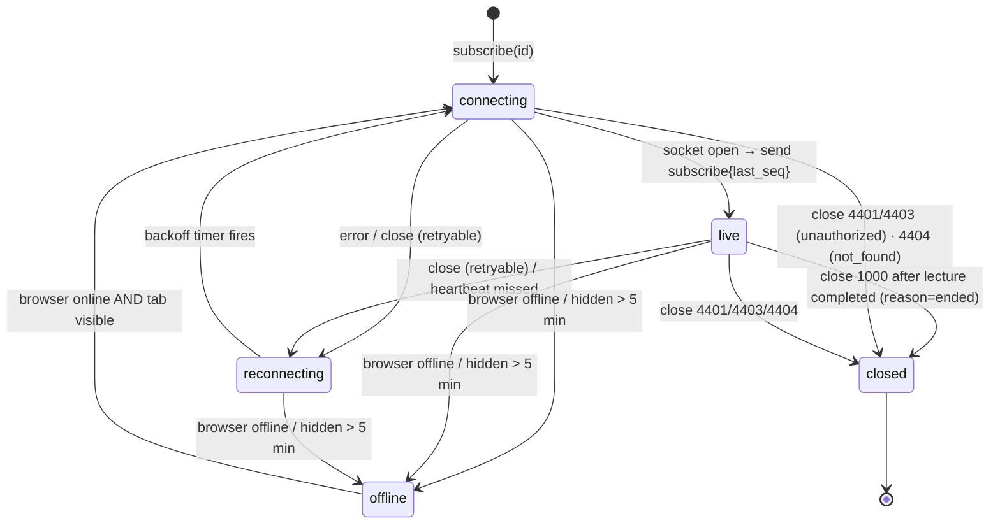

# Design Doc: Smart Classroom Web Frontend

Status: **Approved 2026-11-19**: all deviations D1-D9 accepted, plus the decisions below.

### Decisions recorded after approval

| Topic | Decision |
|---|---|
| Real-time protocol | Extended: `transcript.gap`, `server_ts` on every message, `ping`/`pong`, `key_terms.update` (resolves Q1, Q2, Q3, Q5). Documented in `CONTRACT_ASSUMPTIONS.md`. |
| Recording control | Device button only. The UI tells the lecturer to press record and has no start/stop API (Q20). |
| Timestamps | Offset from lecture start (`12:34`), with wall-clock time in a tooltip (Q8). |
| Admin | Full admin: devices registration (`POST /devices`) and user management (`GET/POST /users`, `PATCH /users/{id}`) added to the contract and mocked (Q18). |
| Status colours | Defaults from §7 (Q19). |
| Quiz answers | Sent to the client; quizzes are self-revision only (Q15). |
| Language preference | All four: per-segment language labels, filter by language, transliteration (new optional `transliteration` field on segments), UI language picker (English enabled, Telugu and Hindi listed as coming) (Q21). |
| Notes editing | Markdown per section with live preview. |
| Pacing | Build M1-M7 straight through, with one combined report. |
| Deployment | Same domain behind one reverse proxy (`/api`, `/ws`) (Q7). |
| Ask | Non-streaming JSON (Q16). |
| Export | Immediate streamed download with `Content-Length` (Q17). |
| AI models | The backend uses Amazon Bedrock for notes, summary, key terms, questions and Ask. Speech-to-text stays on faster-whisper. The browser never calls Bedrock (that would expose AWS credentials). The frontend labels study material as AI-generated. |

This document covers routes, component trees, state ownership, the WebSocket manager, folder layout, dependencies, and the open questions about the backend contract. No code is written until it is approved.

---

## 0. Proposed deviations (need your sign-off)

Each row is a place where I think the brief should change, with the reason. If you reject one, I follow the brief as written.

| # | Brief says | I propose | Why |
|---|---|---|---|
| D1 | Validate API data with Zod, no `as` casts | REST: use `openapi-fetch` on top of the `openapi-typescript` types, so responses are typed without any cast. Keep Zod for WebSocket messages and forms. Type MSW fixtures with the generated types so `tsc` catches mock/contract drift. | Handwritten Zod schemas for about 20 REST shapes would duplicate the generated types, which the brief forbids. FastAPI already enforces `response_model` on the server. If you still want runtime checks on REST, the fallback is to generate Zod from the same OpenAPI file with `@hey-api/openapi-ts`. That adds a second generator and roughly 15-25 KB of schemas. |
| D2 | Sanitise rendered markdown with DOMPurify | Render notes with `react-markdown` and turn raw HTML off (`skipHtml`). Keep its default URL filter, which strips `javascript:` links. | `react-markdown` builds React elements and never uses `innerHTML`, so there is no HTML-injection path to sanitise. DOMPurify would be dead weight. If the backend ever sends HTML, DOMPurify gets added then. |
| D3 | Connection states: `connecting \| live \| reconnecting \| offline` | Add a fifth, terminal state: `closed`, with a reason of `ended`, `unauthorized` or `not_found`. | The brief's four states can't express "the lecture ended, so we disconnected on purpose". Without `closed`, a student would see "Offline, reconnecting…" after class ends. |
| D4 | Detail tabs stored in the URL | Make the tabs nested routes, e.g. `/lectures/:id/notes`, rather than `?tab=notes`. | The tab is still URL state. Nested routes also give each tab its own code-split chunk and its own error boundary. |
| D5 | React 18+ | React 19 | It is the current stable release and works with every library on the list. |
| D6 | Types generated from FastAPI `/openapi.json` | Until the backend is ready, hand-author `openapi/contract.yaml` as the single source and generate types from it. When the backend is up, `npm run api:generate` points at its `/openapi.json` and the diff shows what changed. | Generation needs a schema to read. Writing the contract file is not writing duplicate types. |
| D7 | Yellow = network disconnected | Keep the yellow fill but pair it with a dark-amber icon, label and border. Never use yellow alone as text or as a thin stroke. | Pure yellow on a white surface is about 1.6:1, below the WCAG 3:1 minimum for non-text UI. |
| D8 | Red = recording | Use a separate `--color-danger` token (deeper crimson) for errors. Errors never appear in a status pill. | Red already means "recording" on the device LED. An error drawn in the same red would read as "recording" to someone who knows the device. |
| D9 | `src/features/` list | Add `features/home/` (role-based home) and `features/admin/` (subjects). | Neither fits cleanly in any of the listed features. |

---

## 1. Route map

Every route is `lazy()` and has its own `errorElement`. Guards run in route loaders (`requireAuth`, `requireRole`). They exist for UX only; the backend enforces permissions.

| Path | Screen | Roles | URL state |
|---|---|---|---|
| `/login` | Login | public | `?next=` |
| `/` | Home (lecturer and student variants) | all | none |
| `/lectures/:id/live` | Live Lecture | all | none (live state is not URL state) |
| `/lectures` | Lecture Library | all | `?subject=&from=&to=&status=` |
| `/lectures/:id` | redirects to `transcript` | all | none |
| `/lectures/:id/transcript` | Detail › Transcript | all | `?t=<ms>&seg=<segment_id>&q=<in-lecture query>` |
| `/lectures/:id/notes` | Detail › Notes | all (edit: lecturer) | `#<section-id>` for the table of contents |
| `/lectures/:id/summary` | Detail › Summary | all | none |
| `/lectures/:id/key-terms` | Detail › Key Terms | all | none |
| `/lectures/:id/questions` | Detail › Questions | all | none (quiz state is ephemeral) |
| `/lectures/:id/ask` | Detail › Ask | all | none |
| `/search` | Global Search | all | `?q=&subject=` |
| `/devices` | Devices list | lecturer, admin | none |
| `/devices/:id` | Device detail | lecturer, admin | none |
| `/settings` | Settings | all | none |
| `/admin/subjects` | Subjects | admin | none |
| `*` | Not found | all | none |

The app shell (skip link, header nav, `<main>`) wraps every route except `/login`. On phones the nav becomes a bottom tab bar with Home, Library, Search and Settings.

---

## 2. Component trees

Notation: **[C]** is a container (reads data through hooks), **[P]** is presentational (props only), **⟂** marks a widget-level error boundary.

### 2.1 Live Lecture: `/lectures/:id/live`

```
LiveLectureRoute                          route module: loader prefetches lecture; errorElement
└─ LiveLecturePage [C]                    useLecture(id) (Query) + useLiveSession(id) (WS → liveStore)
   ├─ LiveHeader [P]                      condenses to two rows at 360 px
   │  ├─ StatusBadge [P]                  lecture status: colour + icon + label
   │  ├─ ElapsedTime [P]                  duration_ms + local tick (useSyncExternalStore clock)
   │  ├─ LanguageIndicator [P]            language of the latest segment
   │  ├─ ConnectionIndicator [P]          connection state + latency ("—" when unknown)
   │  └─ AnnounceToggle [C]               opt-in screen-reader mode (prefsStore)
   ├─ ⟂ DeviceAlertBanner [C]             derives a problem from device.status → Banner [P]
   │                                      e.g. "The microphone has lost Wi-Fi. Recording continues
   │                                      on the device and will sync automatically."
   ├─ LiveLayout [P]                      CSS grid: transcript | side panel (≥ 960 px);
   │  │                                   below that, the side panel becomes a Radix Dialog sheet
   │  ├─ ⟂ LiveTranscriptPanel [C]        selects timeline items from liveStore
   │  │  ├─ TranscriptList [P]            shared with Detail; TanStack Virtual, dynamic row height
   │  │  │  ├─ SegmentRow [P]             timestamp · text with lang={language} · partial style · copy
   │  │  │  └─ GapRow [P]                 "Audio 10:32–10:35 syncing…" → replaced in place
   │  │  ├─ JumpToLiveButton [P]          visible only when the user has scrolled away from the bottom
   │  │  └─ LiveAnnouncer [P]             visually hidden aria-live="polite"; only newly *final*
   │  │                                   segments, throttled, only when opted in
   │  └─ ⟂ LiveKeyTermsPanel [C]          useKeyTerms(id), see open question Q5 → KeyTermList [P]
   └─ (Toasts via the app-level Radix Toast viewport: "Reconnected", "Lecture ended")
```

Auto-scroll rule: an `isAtBottom` flag (tolerance of 48 px) is updated on scroll. When a new item is appended and `isAtBottom` is true, the list scrolls to the end. Otherwise it stays put and `JumpToLiveButton` appears. Inserting a backfilled segment above the viewport keeps the reading position anchored, so the text the user is reading doesn't jump.

### 2.2 Lecture Detail: `/lectures/:id/*`

```
LectureDetailLayout [C]                   route: loader prefetches lecture; errorElement
├─ LectureHeader [P]                      title · subject · date · duration · languages · StatusBadge
│  └─ ExportMenu [C]                      Radix DropdownMenu (PDF/TXT/MD) → useExport → ExportProgress [P]
├─ LectureTabs [P]                        Radix Tabs, value = current child route, onValueChange = navigate
└─ <Outlet/>                              each tab is a lazy child route with its own errorElement
   ├─ TranscriptTab [C]                   useTranscript(id): infinite query, fetches all pages
   │  ├─ TranscriptSearchBar [P]          ?q= in URL · "3 of 17" · prev/next (Enter / Shift+Enter)
   │  ├─ TranscriptList [P]               same component as Live; highlight ranges, active segment,
   │  │                                   scrollToIndex(segment at ?t), focus moved to that row
   │  └─ GapRow [P]                       unfilled gaps: "Audio 10:32–10:35 was not recorded"
   ├─ NotesTab [C]                        useNotes(id); students only see published notes
   │  ├─ NotesToc [P]                     sticky on desktop, disclosure on mobile
   │  ├─ NotesView [P]                    react-markdown per section, no raw HTML
   │  └─ NotesEditor [C] (lazy chunk)     lecturers only; RHF + Zod; Save (PATCH) ·
   │                                      Regenerate / Publish behind a Radix Dialog confirm
   ├─ SummaryTab [C] → SummaryView [P]
   ├─ KeyTermsTab [C] → KeyTermList [P]   semantic <dl>
   ├─ QuestionsTab [C]
   │  ├─ McqQuiz [C]                      useReducer: answers, submitted, score
   │  │  ├─ McqQuestion [P]               radio group; feedback after submit
   │  │  └─ QuizResult [P]                score + "Retry" + links to the transcript at each question's source
   │  └─ ShortAnswerList [P]              each item has a "Show model answer" disclosure
   └─ AskTab [C]                          thread = useMutationState(['ask', id]), so no extra store
      ├─ AskThread [P]
      │  └─ AnswerCard [P]                answer text + CitationChip[] → links to transcript?t=&seg=
      │                                   with no citations: "This answer isn't linked to the transcript.
      │                                   Check it against the lecture before relying on it."
      └─ AskForm [P]                      RHF + Zod
```

`TranscriptList` and `SegmentRow` live in `features/lectures/components/transcript/` and are imported by `live-lecture`. That is the one approved cross-feature import. Alternatively they could move to `components/`, but they are domain components rather than design-system ones.

---

## 3. State ownership

Rule: every piece of data has exactly one owner.

| Data | Owner | Key / location | Notes |
|---|---|---|---|
| Current user + role | TanStack Query | `['auth','me']` | A 401 from any request clears it and sends the user to `/login?next=` |
| Subjects | Query | `['subjects']` | staleTime 10 min |
| Lecture list | Query (infinite) | `['lectures','list',filters]` | filters come from the URL |
| Lecture metadata | Query | `['lectures',id]` | |
| Transcript (any non-live view) | Query (infinite) | `['lectures',id,'transcript']` | All pages are fetched; in-lecture search runs client-side over them |
| Notes / summary / key terms / questions | Query | `['lectures',id,'notes'\|'summary'\|'key-terms'\|'questions']` | `notes.ready` on the socket invalidates these keys |
| Ask conversation | Query mutation cache | mutationKey `['ask',id]` | Survives tab switches; cleared on reload |
| Search results | Query | `['search',q,subject]` | |
| Devices (outside the live screen) | Query | `['devices']`, `['devices',id]` | Refetched every 15 s while the page is visible |
| **Live** transcript timeline, live lecture status, live device status, `lastSeq` | `LiveSocketManager` → `liveStore` (Zustand vanilla) | `liveStore` | Exists only while the Live screen is mounted |
| Connection state, latency | `liveStore` | | |
| Preferences: theme, font size, auto-scroll default, language labels, SR announce | Zustand `prefsStore` (persisted to localStorage) | | No tokens or PII; storage access wrapped in try/catch |
| Library filters, search query, tab, `t`, `seg`, in-lecture `q` | URL | `useSearchParams` / route params | |
| Active match index in transcript search | Component state | | Ephemeral |
| Quiz answers and score | Component `useReducer` | | Ephemeral |
| Form state | React Hook Form | | |
| `isAtBottom`, mobile panel open | Component state | | |

Handoff between live and recorded: when `lecture.status` reaches `completed`, the Live screen invalidates `['lectures',id]` and the transcript key, shows a "Lecture ended: open notes and transcript" call to action, and the manager closes with reason `ended`. The live timeline is discarded on unmount, so the same data is never kept in two places.

---

## 4. WebSocket manager

### 4.1 Shape

```ts
class LiveSocketManager {
  constructor(deps: {
    url: (lectureId: string) => string;
    createSocket: (url: string) => WebSocket;   // injected → MSW / fake socket in tests
    clock: { now(): number };                   // injected → deterministic tests
    random: () => number;                       // injected → deterministic jitter
    timers: TimerApi;                           // setTimeout / clearTimeout
    visibility: VisibilitySource;               // document.visibilityState + events
    network: NetworkSource;                     // navigator.onLine + online/offline events
    logger: Logger;                             // dev → console.warn; prod → no-op (no console.log)
  });
  subscribe(lectureId: string): void;           // one lecture at a time; switching closes the previous socket
  unsubscribe(): void;
  readonly store: StoreApi<LiveState>;          // Zustand vanilla store
}
```

A single app-wide instance lives in `api/ws/`, outside React. React reaches it only through `useLiveSession(id)`, which subscribes on mount and unsubscribes on unmount, and through selector hooks such as `useLiveTimeline()`, `useConnection()` and `useDeviceStatus()`.

### 4.2 Connection state machine

The transition logic is a pure function `transition(state, event) → { state, effects[] }` in `connectionMachine.ts`. The class only runs the effects. This keeps every transition unit-testable without a socket.



- **Backoff:** full jitter, `delay = random() × min(30 000, 500 × 2^attempt)` ms. `attempt` resets to 0 after the first valid message on a new socket, not on `open`, so a server that accepts and then immediately drops connections still backs off.
- **Hidden tab:** on `hidden`, start a 5-minute timer. If it fires, close the socket and enter `offline` with reason `hidden`. On `visible`, cancel the timer, or reconnect immediately (attempt 0) if it already fired. Hidden for less than 5 minutes leaves the socket untouched.
- **Network:** a `navigator.onLine` false event goes straight to `offline` with reason `network` and no retry spam. The `online` event reconnects immediately.
- **Resume:** every (re)connect sends `{ "type": "subscribe", "lecture_id", "last_seq" }`, where `last_seq` is the highest seq applied.

### 4.3 Message pipeline (per frame)

1. `JSON.parse` inside try/catch. On failure: log (dev only) and drop.
2. `ServerMessage.safeParse` (a Zod discriminated union on `type`). On failure: log and drop. The app never crashes on bad input.
3. Seq gate: if `seq <= lastSeq`, drop it as a duplicate (expected after a resume). If `seq > lastSeq + 1`, keep it but log the gap. TCP ordering means a gap is a server-side issue, and segment-level dedupe keeps the transcript correct anyway.
4. `applyMessage(liveState, msg)`, a pure reducer in `features/live-lecture/model/`.
5. Set `lastSeq = msg.seq` and record latency (see Q2).

### 4.4 Timeline model (pure, unit-tested)

```
segments: Map<segment_id, Segment>       Segment = { …fields, state: 'partial' | 'final' }
gaps:     Map<gap_id, Gap>                Gap = { start_ms, end_ms | null, state: 'pending' | 'filled' }
order:    TimelineItem[]                  sorted by (start_ms, kind, segment_id), binary insert O(log n)
```

- `transcript.partial`: upsert, unless the stored segment is already `final`. A late partial never downgrades a final.
- `transcript.final`: upsert and replace any partial with the same `segment_id`. If `start_ms` changed, move the item.
- `transcript.backfill`: insert every segment as final, deduped by `segment_id`. Remove any pending gap that overlaps `gap`.
- Ordering always uses `start_ms`, never arrival time.
- Items expose stable keys so TanStack Virtual can keep row measurements across inserts.

---

## 5. Folder structure

```
.
├─ openapi/contract.yaml            REST contract (source of truth until the backend is live; D6)
├─ CONTRACT_ASSUMPTIONS.md          every assumption from §8, kept current
├─ e2e/                             Playwright specs + axe checks; runs against the mock-mode build
├─ scripts/check-bundle-size.mjs    gzip budget gate (≤ 200 KB initial JS), no extra dependency
└─ src/
   ├─ main.tsx                      starts MSW only when VITE_ENABLE_MOCKS === 'true' (statically
   │                                replaced, so the dynamic import is tree-shaken out of production)
   ├─ app/
   │  ├─ router.tsx  routes.ts      route objects; typed path builders (paths.lectureTranscript(id, {t}))
   │  ├─ guards.ts                  requireAuth / requireRole loaders
   │  ├─ providers/                 QueryClientProvider, i18n, ThemeController, Toast viewport
   │  ├─ shell/                     AppShell, SkipLink, TopNav, BottomNav
   │  ├─ errors/                    RouteErrorBoundary, WidgetErrorBoundary, NotFound
   │  └─ i18n/                      i18next setup; locales/en/{common,live,lectures,study,…}.json
   ├─ api/
   │  ├─ generated/schema.d.ts      openapi-typescript output (never edited by hand)
   │  ├─ client.ts                  openapi-fetch; credentials:'include'; CSRF header; ApiError mapping
   │  ├─ queryClient.ts  queryKeys.ts
   │  └─ ws/                        LiveSocketManager, connectionMachine, backoff, messages (Zod), liveStore
   ├─ features/
   │  ├─ auth/                      LoginRoute, LoginForm, useMe, useLogin, useLogout
   │  ├─ home/                      LecturerHome (PrepareLectureForm, DeviceCard, RecentLectures), StudentHome
   │  ├─ live-lecture/              model/ (timeline, applyMessage), hooks/, components/, route
   │  ├─ lectures/                  library/, detail/, components/transcript/ (TranscriptList, SegmentRow, GapRow)
   │  ├─ search/
   │  ├─ study/                     notes/, summary/, key-terms/, questions/, ask/
   │  ├─ devices/
   │  ├─ settings/                  prefsStore, SettingsRoute
   │  └─ admin/                     SubjectsRoute
   │      (each feature: components/, hooks/, api.ts (query options), schemas.ts, *.test.tsx)
   ├─ components/                   Button, IconButton, StatusBadge, Banner, Skeleton, EmptyState,
   │                                ErrorState, Dialog, DropdownMenu, Tabs, Tooltip, Toast, Field,
   │                                TextInput, Select (native), Timestamp, VisuallyHidden
   ├─ styles/                       tokens.css, theme-light.css, theme-dark.css, reset.css,
   │                                typography.css, fonts.css
   ├─ lib/                          time.ts, highlight.ts, sortedInsert.ts, lang.ts, download.ts, cx.ts
   └─ test/
      ├─ msw/                       handlers/*.ts (REST), ws.ts (live lecture simulator), browser.ts, node.ts
      ├─ fixtures/                  50-min OS lecture (~600 segments, EN/TE/HI, one offline gap),
      │                             subjects, users, devices, notes, questions; typed with generated types
      └─ utils/                     renderWithProviders, createTestQueryClient, fake socket
```

---

## 6. Dependencies

Versions are the latest stable at install time, pinned by the lockfile.

**Runtime**

| Package | Why |
|---|---|
| `react`, `react-dom` | UI runtime (D5) |
| `react-router` | Data router, `lazy` routes, loaders for guards and prefetch |
| `@tanstack/react-query` | Owner of all REST data, plus retries, invalidation and infinite queries |
| `@tanstack/react-virtual` | Virtualized transcript (~600 rows, variable height) and library |
| `zustand` | `liveStore` (vanilla, written from outside React) and the persisted `prefsStore` |
| `zod` | Runtime validation of every WebSocket message and every form |
| `react-hook-form`, `@hookform/resolvers` | Forms with Zod schemas |
| `openapi-fetch` | ~6 KB typed fetch on the generated `paths` type, so no casts (D1) |
| `@radix-ui/react-dialog`, `-dropdown-menu`, `-tabs`, `-tooltip`, `-toast` | Accessible primitives, styled with our own CSS Modules |
| `lucide-react` | Tree-shakable icons |
| `date-fns` | Tree-shakable date formatting |
| `i18next`, `react-i18next` | UI strings; English now, structured for Telugu and Hindi later |
| `react-markdown` | Notes rendering without `innerHTML` (D2), lazy-loaded with the Notes tab |
| `@fontsource-variable/inter`, `@fontsource/noto-sans-telugu`, `@fontsource/noto-sans-devanagari` | Self-hosted fonts. `unicode-range` means Telugu and Devanagari files download only when those glyphs appear. |

Deliberately left out: Tailwind (the brief asks for CSS Modules), `clsx` (`lib/cx.ts` is 5 lines), Radix Select and Popover (native `<select>` and `<input type="date">` are more accessible on phones), a date-picker library, a rich-text editor (notes are markdown with a live preview), `axios`, and `ajv` (fixtures are type-checked against the generated types instead).

**Dev**

| Package | Why |
|---|---|
| `vite`, `@vitejs/plugin-react`, `typescript` | Build and type-check (`strict`, `noUncheckedIndexedAccess`, `exactOptionalPropertyTypes`) |
| `openapi-typescript` | Generates `api/generated/schema.d.ts` |
| `vitest`, `@vitest/coverage-v8`, `jsdom` | Unit and component tests |
| `@testing-library/react`, `@testing-library/user-event`, `@testing-library/jest-dom` | Component tests that work through user behaviour |
| `msw` | REST and WebSocket mocks shared by Vitest, dev mode and Playwright |
| `@playwright/test`, `@axe-core/playwright` | E2E tests and an axe check on every route |
| `eslint`, `typescript-eslint`, `eslint-plugin-react-hooks`, `eslint-plugin-jsx-a11y`, `eslint-config-prettier` | Lint rules from the brief, plus custom bans on `console.log`, `any`, inline `style` and raw hex colours outside `styles/` (via `no-restricted-syntax` and a stylelint-free CSS check script) |
| `prettier`, `husky`, `lint-staged` | Formatting and pre-commit gate |
| `rollup-plugin-visualizer` | Bundle analysis (M7) |

---

## 7. Design system summary

- **Tokens** (`styles/tokens.css`): `--space-1..12` on a 4 px scale; `--radius-sm/md/lg`; `--font-size-*` (body 17 px, the user setting scales `--transcript-font-size` from 15 to 22 px); `--leading-body: 1.6`; `--measure: 70ch`; `--shadow-1/2`; `--duration-fast/base`, zeroed under `prefers-reduced-motion`.
- **Semantic colours**, defined once per theme: `--color-surface`, `--color-surface-raised`, `--color-text`, `--color-text-muted`, `--color-border`, `--color-accent` (one accent, a deep teal), `--color-focus-ring`, `--color-danger`, and the status tokens `--color-status-recording`, `-processing`, `-connected`, `-disconnected`, `-idle`, each as a `-fill` / `-fg` / `-border` triple. Every pair is checked for AA contrast in both themes by a unit test that parses the token files.
- **Status mapping** (always colour + icon + label):

  | Meaning | LED | Icon | Label |
  |---|---|---|---|
  | Lecture `recording` | Red | `Circle` (filled) | Recording |
  | Lecture `processing` | Blue | `Loader` | Processing |
  | Lecture `completed` / device online | Green | `CheckCircle2` / `Wifi` | Completed / Connected |
  | Device offline / our socket offline | Yellow | `WifiOff` | Disconnected |
  | Lecture `scheduled`, `paused`, device idle | Grey | `CalendarClock`, `Pause`, `Circle` | Scheduled, Paused, Idle |
  | Lecture `failed` | Grey + danger icon (D8, Q19) | `AlertTriangle` | Failed |

- **Theme switching:** `data-theme` on `<html>` when set explicitly; otherwise `prefers-color-scheme` applies. A blocking inline script is avoided (CSP friendly). The theme class is set in `main.tsx` before the first render.

---

## 8. Risks and open questions about the backend contract

Each item gets a default assumption. I'll build against that default and record it in `CONTRACT_ASSUMPTIONS.md` unless you answer differently.

**Real-time protocol**

1. **Gap before backfill (highest impact).** No message announces that a gap has *started*, so "Audio 10:32–10:35 syncing…" can't be shown until the backfill arrives, and by then it isn't needed. Proposal: a new message `transcript.gap { seq, gap_id, gap: { start_ms, end_ms | null } }`. Default if refused: infer the gap from `device.status.online === false`, starting at the last final `end_ms`, shown open-ended as "Audio from 10:32 syncing…", and closed by the matching backfill.
2. **Latency needs a server timestamp.** No message carries one. Proposal: add `server_ts` (epoch ms) to every message, plus a client `ping {client_ts}` → `pong {client_ts, server_ts}` to estimate clock offset. Default: show latency as "—" when `server_ts` is missing.
3. **Heartbeat.** Dead sockets on mobile networks can go undetected for minutes. Proposal: the same ping/pong every 15 s, with two misses triggering a reconnect. Default: rely on close events only, and record this as a known limitation.
4. **Replay window.** How far back does `last_seq` resume? Does `last_seq: 0` replay the whole lecture for a student who joins late? Default: yes, a full replay. If `last_seq` is older than the server's buffer, assume `error { code: "resync_required" }`, after which the client clears the timeline and resubscribes with `last_seq: 0`.
5. **Live key terms.** No message carries key terms during a lecture. Proposal: `key_terms.update { seq, terms: [...] }`. Default: poll `GET /lectures/{id}/key-terms` every 30 s while the lecture is `recording`.
6. **Close codes.** Default: `4401` unauthenticated, `4403` forbidden, `4404` lecture not found, `1000` after `completed`/`failed`. Anything else is retryable.
7. **WebSocket authentication.** Cookies go with the WS handshake only if the API and WS hosts are same-site. Default: same-site deployment; Vite proxies `/api` and `/ws` in development.
8. **Time base.** Is `start_ms` relative to the lecture start? The brief's "10:32" example looks like clock time. Default: relative. Show `mm:ss` offsets, with wall-clock time in a tooltip computed from `lecture.started_at`, which must be in the lecture response.
9. **Language codes.** Default: ISO 639-1 (`en`, `te`, `hi`), applied directly as the `lang` attribute.

**REST**

10. **CSRF.** Default: double-submit. The backend sets a readable `csrftoken` cookie and the client echoes it in `X-CSRF-Token` on POST/PATCH/DELETE.
11. **Transcript pagination.** Default: `{ items, next_cursor }` ordered by `start_ms`, about 200 items per page. The client fetches all pages, since about 600 segments is roughly 150 KB of JSON.
12. **Search highlight offsets.** Python counts code points, while JS strings are UTF-16. Default: code-point offsets, converted on the client. Telugu and Devanagari are BMP-only so the values match today, but the conversion protects against emoji and other astral characters.
13. **Notes shape.** Default: `{ sections: [{ id, heading, body_markdown }], published, updated_at, version }`. `PATCH` sends `version`, and a `409` shows "These notes were changed elsewhere. Reload to see the latest version." `regenerate` returns `202`, and completion arrives as `notes.ready` or is detected by polling.
14. **Unpublished notes for students.** Default: `404` with `code: "notes_not_published"`, shown as "Notes haven't been published yet."
15. **Questions shape.** Default: MCQs include `correct_index` and an `explanation`, so students can find the answer in browser devtools. That is fine for self-revision quizzes but not for graded tests. Please confirm.
16. **Ask.** Default: a non-streaming JSON response `{ answer, citations: [{ segment_id, start_ms }] }`. If citations include only `segment_id`, the client resolves `start_ms` from the transcript cache.
17. **Export.** Default: a synchronous stream with `Content-Length` and `Content-Disposition`, so the progress bar is determinate. Without `Content-Length` it falls back to an indeterminate bar. If PDF generation is slow and asynchronous, the flow needs a job endpoint.
18. **Admin endpoints are missing.** The contract has no user management and no `POST /devices` for device registration. Default: the admin feature covers subjects only, and device and user management wait for endpoints.

**Product questions (not just API)**

19. **Status colours not covered by the LED list:** `failed`, `paused`, `scheduled`, and a device that is online but not recording (green "Connected" or grey "Idle"?). What does the physical LED show in each case? My defaults are in the §7 table.
20. **Who starts recording?** Does the lecturer press the button on the device after "Prepare lecture", or should the web UI also have Start/Pause/Stop? Default: the device button. The UI shows "Press the record button on the device to start", and no start/stop endpoint is assumed.
21. **"Language display preference."** Default: a toggle for showing a language label (EN/TE/HI) on each segment, plus a placeholder for UI language. Was transliteration intended?
22. **Lecturer ↔ device.** Default: `GET /devices` returns only the devices a lecturer may use, and the Prepare form picks one (pre-selected if there is only one).
23. **Roles.** Default: exactly one role per user: `lecturer`, `student` or `admin`.

**Frontend risks**

- **Variable-height virtualisation plus auto-scroll plus mid-list inserts** is the hardest UI problem here. Mitigation: `measureElement`, stable keys, scroll anchoring on insert above the viewport, and dedicated component tests and E2E scenario #2.
- **Font weight:** Noto Telugu and Devanagari are large. Mitigation: `unicode-range` subsets, `font-display: swap`, only the 400 and 600 weights.
- **iOS Safari** suspends sockets in background tabs. This is covered by the visibility logic and a resume using `last_seq`.
- **Initial JS budget (≤ 200 KB gzip):** React 19 plus Router plus Query plus i18n plus Zod is about 110-120 KB, which leaves room. A CI script fails the build on regression.

---

## 9. Milestone plan (unchanged from the brief)

M1 scaffold, tooling, tokens, shell, routing, auth → M2 contract, client, MSW and fixtures → M3 WebSocket manager and Live Lecture → M4 Library and Transcript tab → M5 study tabs → M6 search, devices, settings, export → M7 accessibility, performance, full E2E, README.

At the end of each milestone, lint, type-check and tests must pass, and I report what was built, how to run it, how to test it, and its known limitations.
