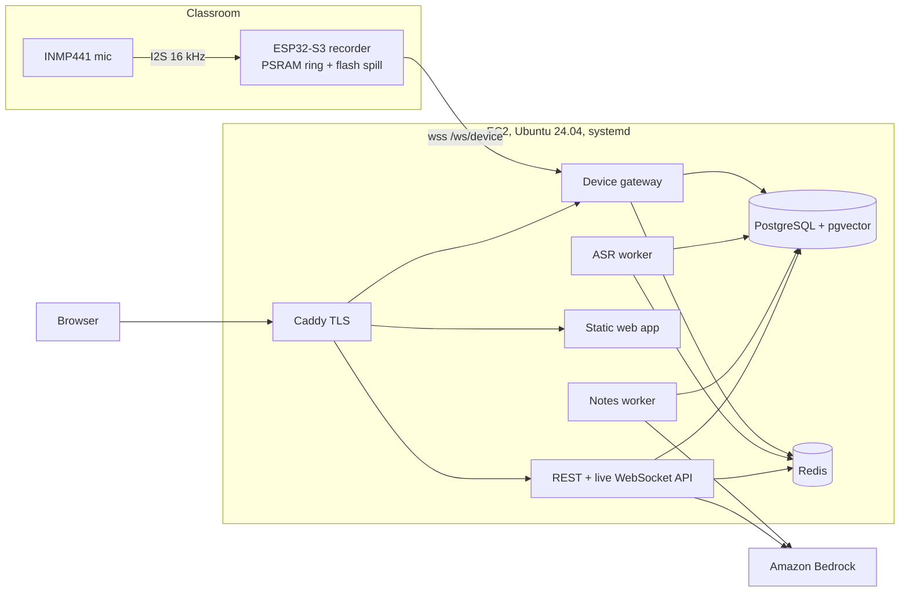

# IoT-Based Smart Classroom Lecture Capture and Real-Time AI Speech-to-Text System

**Project report: B.Tech, Computer Science and Engineering**

> Fill in before submission: student names and roll numbers, guide, department, institution, academic year, and the measured results in Chapter 9. Every number in this report that was not measured on real hardware is marked *to be measured*.

---

## Abstract

Students in Indian classrooms often miss parts of a lecture: they fall behind while taking notes, they are absent, or the lecturer switches between English, Telugu and Hindi. This project builds a complete system that records a lecture with a small device on the lecturer's desk and shows a live, multilingual transcript in students' browsers within seconds. After the lecture it generates study material.

The device is an ESP32-S3 microcontroller with an INMP441 I²S MEMS microphone, an OLED display, an RGB status LED and three buttons (Start, Stop, Pause/Resume). It streams 0.5-second audio chunks over a secure WebSocket. If Wi-Fi drops, it keeps recording into PSRAM and internal flash and resends the backlog when the connection returns, so no audio is lost. The server runs on a single AWS EC2 instance without containers:
- a device gateway, a REST/WebSocket API, a speech-recognition worker and an AI worker, all in Python with FastAPI;
- PostgreSQL with pgvector, and Redis.

Speech recognition uses faster-whisper (Whisper large-v3 class models) with a local-agreement streaming algorithm. Study material comes from Amazon Bedrock: notes, a summary, key terms, practice questions, flashcards and revision notes, plus a question-answering feature grounded in the transcript. The web application is built with React and TypeScript. It provides:
- a live lecture view with device monitoring and recording controls;
- a lecture library, search, and study tabs;
- device and user administration.

The software is covered by automated tests: backend, evaluation tooling, frontend unit tests, and end-to-end browser tests including accessibility checks. Evaluation scripts measure word error rate, end-to-end latency and recovery after network outages.

**Keywords:** IoT, ESP32-S3, I²S microphone, speech-to-text, Whisper, code-switching, WebSocket, Amazon Bedrock, retrieval-augmented generation, lecture capture.

---

## Table of contents

1. Introduction
2. Literature survey
3. Requirements
4. System architecture
5. Hardware design
6. Firmware design
7. Server design
8. Web application
9. Testing and results
10. Deployment
11. Limitations and future work
12. Conclusion
- References
- Appendices

---

## 1. Introduction

### 1.1 Background

Lectures are the main channel of teaching in engineering colleges. They are spoken, fast and usually not recorded. Students who take notes by hand lose part of what is said while they write. Students with hearing difficulty, students who were absent, and students who are not fluent in the language being spoken lose more. In many Indian classrooms a lecturer explains a concept in English, repeats it in Telugu or Hindi, and mixes languages within a sentence (code-switching), which makes manual note taking harder still.

### 1.2 Problem statement

Design and build a low-cost classroom system that:
1. captures the lecturer's speech reliably, even when the classroom Wi-Fi is unreliable;
2. shows a live transcript in English, Telugu and Hindi with a delay of a few seconds;
3. turns the finished transcript into study material that students can search and revise from;
4. respects consent and data-retention obligations for recorded audio.

### 1.3 Objectives

| # | Objective | Where it is met |
|---|---|---|
| O1 | Capture 16 kHz speech with a dedicated desk device | Chapter 5, 6 |
| O2 | No audio loss during network outages | §6.4, §9.4 |
| O3 | Live multilingual transcript within seconds | §7.3, §9.3 |
| O4 | AI-generated notes, summary, key terms, questions, flashcards, revision notes | §7.4 |
| O5 | Search across lectures and question answering grounded in the transcript | §7.4, §8 |
| O6 | Role-based web application for students, lecturers and administrators | Chapter 8 |
| O7 | Deployable on one cloud server without containers | Chapter 10 |
| O8 | Measurable accuracy, latency and reliability | Chapter 9 |

### 1.4 Scope

**In scope:**
- one device per classroom;
- English, Telugu and Hindi;
- a single-server deployment for one college.

**Out of scope:**
- video capture;
- speaker diarisation (telling apart several speakers);
- graded examinations;
- mobile apps (the web app works on phones).

---

## 2. Literature survey

> Replace this chapter's summaries with the papers your guide asks you to cite, and add full references.

| Area | Existing approach | Gap this project addresses |
|---|---|---|
| Lecture capture systems | Room cameras and microphones that record to a server for later viewing | Recordings are watched after class, not read live, and are rarely searchable |
| Cloud speech APIs | Streaming ASR services from large cloud providers | Cost per minute; weak support for Telugu–English code-switching; audio leaves the institution |
| Whisper | Open, multilingual encoder–decoder ASR trained on large weakly supervised data | Not designed for streaming; it needs a policy for when partial text is "final" |
| Streaming Whisper (local agreement) | Re-decode a sliding window and commit only the prefix that two consecutive passes agree on | Used here with a fixed decode language for stability (decision D6) |
| Embedded audio on ESP32 | I²S MEMS microphones with Wi-Fi streaming | Few designs handle offline buffering and exactly-once delivery |
| Retrieval-augmented generation | Answer questions from retrieved passages, with citations | Applied here to a single lecture transcript with timestamps |

---

## 3. Requirements

### 3.1 Functional requirements

| ID | Requirement |
|---|---|
| F1 | The lecturer prepares a lecture (subject, title, language) and confirms that students have been told it is recorded. |
| F2 | Recording starts from the device's Start button or from the web Live page, and can be paused and resumed from either. |
| F3 | Students see the transcript live, with partial lines that settle into final lines. |
| F4 | If the network drops, the device keeps recording; the transcript shows the gap and fills it when the audio arrives. |
| F5 | After Stop, the system produces notes, a summary, key terms, practice questions, flashcards and revision notes. |
| F6 | The lecturer can correct transcript lines, edit the notes, and publish them to students. |
| F7 | Users can search all lectures they can see and jump to the exact moment in a transcript. |
| F8 | Students can ask questions about a lecture and get answers that cite transcript moments. |
| F9 | Administrators manage subjects, users and devices: register, assign to lecturers, set microphone gain and voice detection. |
| F10 | Transcripts, notes and questions can be exported. |
| F11 | Recorded audio can be deleted automatically after a configured number of days. |

### 3.2 Non-functional requirements

| ID | Requirement | Target |
|---|---|---|
| N1 | Live transcript latency (speech → screen) | a few seconds; *to be measured* (§9.3) |
| N2 | Audio loss during a Wi-Fi outage | zero chunks lost, zero duplicates, within the buffer capacity (§6.4) |
| N3 | Offline buffer | about 12.7 minutes of audio (PSRAM + internal flash) |
| N4 | Security | HTTPS/WSS only; per-device tokens stored as hashes; server-side sessions with CSRF protection |
| N5 | Accessibility | WCAG 2.1 AA, checked automatically with axe on every page |
| N6 | Frontend size | initial JavaScript ≤ 200 KB gzip |
| N7 | Privacy | consent before students can see a lecture; configurable audio retention (India's DPDP Act 2023) |

### 3.3 Hardware and software used

| Hardware | Software |
|---|---|
| ESP32-S3-DevKitC-1 N8R8 (8 MB flash, 8 MB PSRAM) | ESP-IDF 5.x (C) |
| INMP441 I²S MEMS microphone | Python 3.12, FastAPI, SQLAlchemy, Alembic |
| SSD1306 0.96" OLED (I²C) | PostgreSQL 16 + pgvector, Redis |
| Common-cathode RGB LED, 3 push buttons | faster-whisper (CTranslate2) |
| 5 V USB power supply | Amazon Bedrock (LLM + embeddings) |
| AWS EC2 instance (Ubuntu 24.04) | React 19, TypeScript, Vite, TanStack Query |
| | Caddy (TLS), systemd |

---

## 4. System architecture

**Data flow:**
1. The device sends 0.5 s audio chunks, each numbered with a sequence number.
2. The gateway stores each chunk exactly once, keyed on `(lecture_id, seq)`. It acknowledges the chunk and queues the lecture for speech recognition.
3. The ASR worker decodes sliding windows of audio and publishes partial and final transcript events to the lecture's Redis Stream.
4. The API relays the stream to every browser watching the lecture. A browser that reconnects resumes from the last event it saw.
5. After Stop, the ASR worker finalises the transcript and the notes worker generates the study material.

PostgreSQL is the source of truth; Redis holds only short-lived queues and live streams. The main design decisions (D1–D14) are recorded in [docs/DECISIONS.md](../DECISIONS.md). Diagrams are in [UML.md](UML.md).

---

## 5. Hardware design

The circuit and wiring are in [CIRCUIT.md](CIRCUIT.md). Summary:

| Part | Connection |
|---|---|
| INMP441 | SCK→GPIO4, WS→GPIO5, SD→GPIO6 (100 kΩ pull-down), L/R→GND, VDD→3V3 with a 100 nF decoupling capacitor |
| SSD1306 OLED | SDA→GPIO8, SCL→GPIO9, address 0x3C |
| Buttons | Start→GPIO1, Stop→GPIO2, Pause/Resume→GPIO7, each to GND with the internal pull-up |
| RGB LED | R/G/B→GPIO16/17/18 through 220 Ω/100 Ω/100 Ω; common cathode to GND |

**Why these parts:**
- The ESP32-S3 has two cores, hardware I²S, Wi-Fi and 8 MB of PSRAM. The PSRAM gives a large in-memory audio buffer.
- The INMP441 produces a digital signal, so there are no analog noise problems on the board.
- The OLED and LED show the lecturer the recording state at a glance without opening the website.

**Offline storage (a deliberate deviation):**
- The original plan listed a MicroSD card. This build uses the board's internal flash plus PSRAM instead, about 12.7 minutes of audio.
- Reasons: one less part that can be removed or corrupted, and no extra SPI wiring.
- This is enough for the Wi-Fi outages a classroom normally sees.

---

## 6. Firmware design

### 6.1 Tasks

| Task | Core | Job |
|---|---|---|
| `audio` | 1 | I²S DMA capture, 24→16-bit conversion, high-pass filter, gain, 500 ms chunks into the PSRAM ring, level meter, silence warning |
| `net` | 0 | Wi-Fi with back-off, TLS WebSocket, `hello`/`config`, live-first sending with selective ACKs, web commands, status reports |
| `spill` | 0 | Moves un-acknowledged chunks to the flash log as IMA-ADPCM when offline |
| `ui` | 0 | LED and OLED |
| `buttons` | 0 | Start / Stop / Pause with debouncing |

### 6.2 States

`BOOT → WIFI_CONNECTING → SERVER_CONNECTING → READY → RECORDING ⇄ PAUSED`. `RECORDING` becomes `RECORDING_OFFLINE` when the server is unreachable. Stop leads through `SYNCING` and `FINALIZING` back to `READY`. The full diagram is in [UML.md](UML.md).

### 6.3 Protocol

Each audio frame has a 26-byte header: magic `LC`, version, codec (PCM16 or IMA-ADPCM), sequence number, sample offset, capture time, and payload length. JSON control messages carry `hello`, `start`, `resume`, `pause`, `stop`, `status` and `ack`. The full specification is in [contracts/PROTOCOL.md](../../contracts/PROTOCOL.md).

### 6.4 No audio loss: how it works

1. Every chunk stays in the PSRAM ring until the server acknowledges it.
2. While the server is unreachable, any chunk older than 2 s is compressed with IMA-ADPCM (4:1) and written to a flash log. A power cut therefore loses at most about 2 s.
3. On reconnect, the device sends **live audio first** and the backlog in spare bandwidth. This keeps the live transcript current.
4. The server acknowledges with a cumulative sequence number plus "ranges" of stored chunks above it (selective ACKs). The device frees exactly what was stored.
5. The server ignores a chunk it already has, so resending is safe (idempotent storage).
6. Flash records carry a CRC and the session id, so a recording interrupted by a reboot is recovered and uploaded.

---

## 7. Server design

### 7.1 Components

| Process | Responsibility |
|---|---|
| Device gateway | Authenticates devices by token hash; stores chunks; detects gaps; relays web commands (start, pause, resume, stop) to the device; records status (signal, buffers, mic level) |
| API | REST endpoints, cookie sessions with CSRF, role checks, the per-lecture live WebSocket |
| ASR worker | Streaming recognition with faster-whisper and local agreement; per-segment language detection; finalises after Stop; fills gaps (backfill) |
| Notes worker | Calls Amazon Bedrock to produce notes, summary, key terms, questions, flashcards and revision notes; computes embeddings for search and Ask |
| Retention tool | Deletes audio older than `AUDIO_RETENTION_DAYS`, keeping transcripts and notes |

### 7.2 Data model

The main tables:
- users, sessions, subjects, devices, device_lecturers, lectures;
- audio_chunks, lecture_gaps, transcript_segments, lecture_artifacts;
- qa_messages, audit_log, latency_marks, asr_progress.

The class diagram is in [UML.md](UML.md).

### 7.3 Streaming speech recognition

- Whisper processes 30-second windows and is not a streaming model.
- The worker re-decodes a sliding window every few hundred milliseconds. It commits only the words that two consecutive decodes agree on (*local agreement*).
- Uncommitted text is sent as a *partial*, and committed text as a *final*.
- The decode language is fixed to the lecture's language hint, so a language switch cannot stall agreement (D6). The language of each final segment is detected afterwards and shown as EN/TE/HI.

### 7.4 AI features

- **Study material:** Amazon Bedrock generates notes, a summary, key terms, practice questions, flashcards and revision notes from the final transcript. Each prompt asks for structured JSON, and the output is validated before it is stored.
- **Live key terms:** a light pass refreshes key terms every few minutes during recording (D4).
- **Ask:** answers are generated only from the lecture's transcript segments and return the ids of the segments they cite. The web app turns these into "Jump to mm:ss" links.
- **Visibility:** students see AI material only after the lecturer publishes it.

---

## 8. Web application

| Page | Who | What it does |
|---|---|---|
| Home | all | Upcoming and recent lectures; lecturers prepare a new lecture |
| Live | all | Live transcript with partial lines, gap markers and backfill. Lecturers also get Start/Pause/Resume/Stop and line correction. Device monitor: mic level, mic status, Wi-Fi, buffers, sync progress |
| Library | all | Lectures by subject, date and status |
| Lecture | all | Tabs: Transcript, Notes, Summary, Revision, Key terms, Flashcards, Questions, Ask; export |
| Search | all | Full-text search across lectures, with highlighted matches that open the transcript at that moment |
| Devices | lecturer, admin | Device health. Admins register devices, assign lecturers, and set gain and voice detection |
| Settings | all | Profile and password; theme, transcript text size, languages, notifications. Admins also see the server configuration and retention policy |
| Admin | admin | Subjects and users |

The REST types are generated from the server's OpenAPI document, so the client and server cannot silently disagree.

---

## 9. Testing and results

### 9.1 Automated tests

| Part | Tool | Scope |
|---|---|---|
| Backend | pytest on an embedded PostgreSQL | Device protocol over real WebSockets, outage and recovery with a device simulator, ASR pipeline with a deterministic fake model, notes with a scripted LLM, API permissions, retention |
| Evaluation | pytest | WER/CER with Indic-safe normalisation, percentiles, latency pairing, recovery checks |
| Frontend | Vitest + Testing Library + MSW | Pages and components against a mock API and a fake live socket |
| End-to-end | Playwright + axe | Prepare → live, outage gap → backfill, reconnect without duplicates, search → timestamp, quiz, export; WCAG 2.1 A/AA on every page for every role |
| Firmware | host unit tests (CMake) | Framing, ADPCM, ACK ranges, ring buffer, flash log, back-off |

Static checks: ruff and `mypy --strict` (Python); `tsc`, ESLint and Prettier (TypeScript); a CSS design-token lint; a bundle-size budget.

### 9.2 Transcription accuracy

Measure on real classroom recordings with `eval/asr_benchmark.py` (see `eval/README.md`). Report WER for English and CER for Telugu and Hindi.

| Model | Language | WER / CER | Real-time factor |
|---|---|---|---|
| *to be measured* | English | | |
| *to be measured* | Telugu | | |
| *to be measured* | Hindi | | |
| *to be measured* | Code-switched | | |

### 9.3 Latency

Use `eval/latency_report.py` on a recorded lecture session.

| Measure | p50 | p95 |
|---|---|---|
| Capture → partial shown | *to be measured* | |
| Capture → final shown | *to be measured* | |

### 9.4 Network recovery

Use `eval/recovery_report.py` after pulling the Wi-Fi during recording.

| Outage length | Chunks sent | Chunks stored | Lost | Duplicates | Time to fill gap |
|---|---|---|---|---|---|
| 30 s | *to be measured* | | | | |
| 2 min | *to be measured* | | | | |
| 10 min | *to be measured* | | | | |

---

## 10. Deployment

The deployment uses one Ubuntu 24.04 EC2 instance with no Docker (D12):
- PostgreSQL, Redis and Caddy are installed as system packages;
- the four Python services run as systemd units;
- `infra/ec2/setup.sh` prepares the machine once, and `infra/ec2/deploy.sh` installs each release;
- Bedrock is accessed through the instance's IAM role.

Details are in [infra/README.md](../../infra/README.md).

---

## 11. Limitations and future work

**Limitations:**
- The firmware and the real speech and AI models were not run inside the automated test suite. They must be validated on hardware and real recordings (Chapter 9).
- The offline buffer holds about 12.7 minutes; a longer outage loses audio, and the device warns on screen.
- One gateway process holds the device connections, so it does not scale horizontally as written.
- Practice-question answers are sent to the browser, which is fine for revision but not for graded tests.

**Future work:**
- speaker diarisation (lecturer vs. student questions);
- on-device voice activity detection to save bandwidth;
- a MicroSD option for very long outages;
- fine-tuning ASR on local classroom audio;
- a mobile app with offline notes;
- an LMS integration (e.g. Moodle).

---

## 12. Conclusion

The project delivers a working path from a classroom microphone to a live, multilingual transcript and AI study material:
- The device keeps recording through network outages and delivers every chunk exactly once.
- The server turns audio into a live transcript with a streaming policy on top of Whisper.
- Study material from Amazon Bedrock is grounded in the transcript and links back to the moment in the lecture it came from.

The system is built to be measured: the evaluation scripts report accuracy, latency and recovery, so its claims can be checked on real classroom recordings.

---

## References

> Complete these in your department's citation style.

1. A. Radford et al., "Robust Speech Recognition via Large-Scale Weak Supervision" (Whisper), 2022.
2. Espressif Systems, *ESP32-S3 Technical Reference Manual* and *ESP-IDF Programming Guide*.
3. InvenSense (TDK), *INMP441 Omnidirectional Microphone with I²S Digital Output*, datasheet.
4. Solomon Systech, *SSD1306 OLED driver*, datasheet.
5. Amazon Web Services, *Amazon Bedrock User Guide* (Converse API, embeddings).
6. IETF RFC 6455, *The WebSocket Protocol*.
7. W3C, *Web Content Accessibility Guidelines (WCAG) 2.1*.
8. Government of India, *Digital Personal Data Protection Act, 2023*.

## Appendices

- A. Wiring and circuit: [CIRCUIT.md](CIRCUIT.md)
- B. UML diagrams: [UML.md](UML.md)
- C. User manual: [USER_MANUAL.md](USER_MANUAL.md)
- D. Device and browser protocol: [contracts/PROTOCOL.md](../../contracts/PROTOCOL.md)
- E. Demo script: [DEMO_SCRIPT.md](DEMO_SCRIPT.md)
