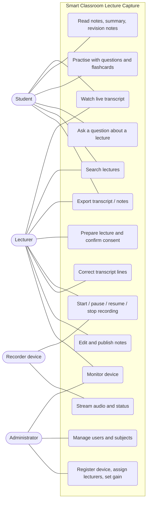
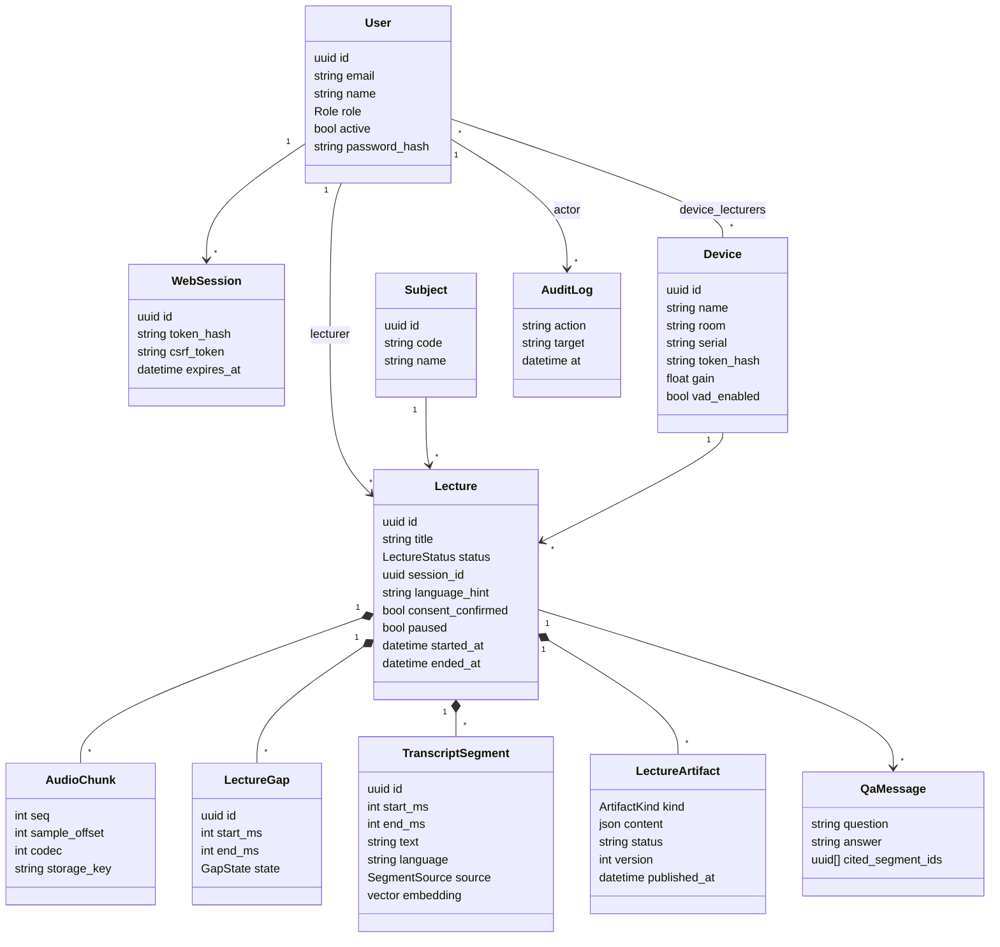
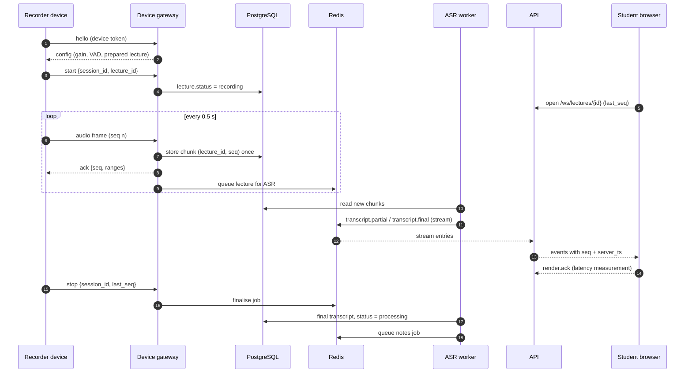
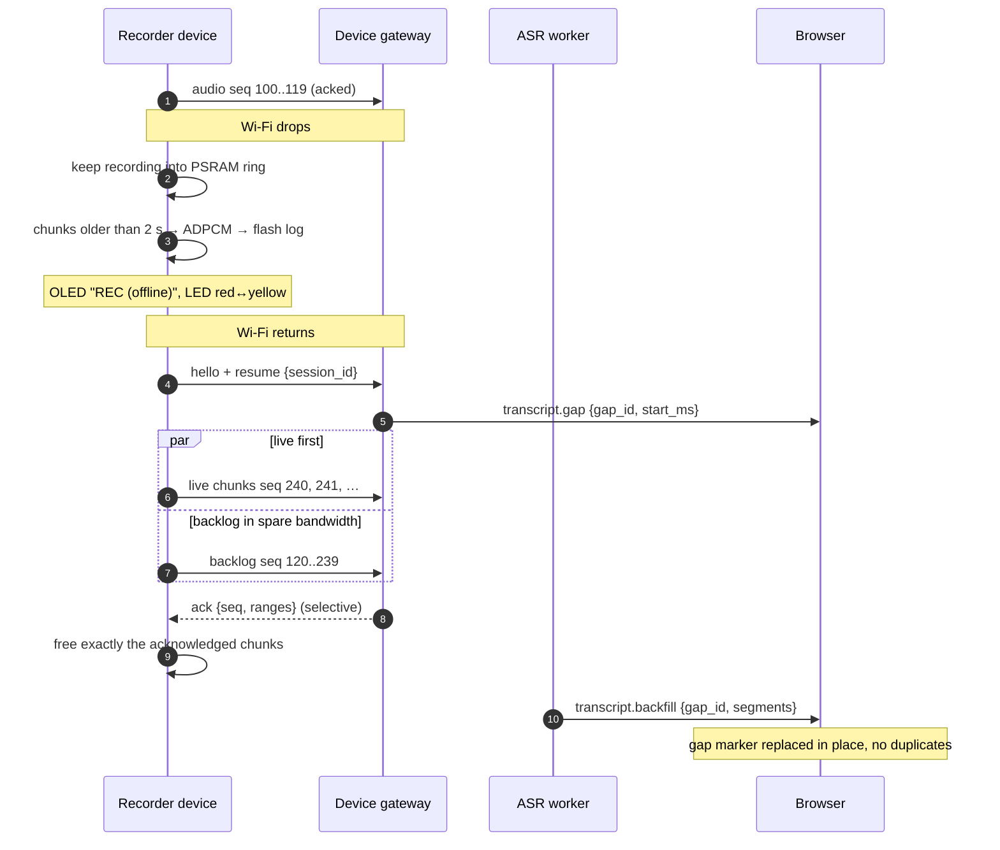
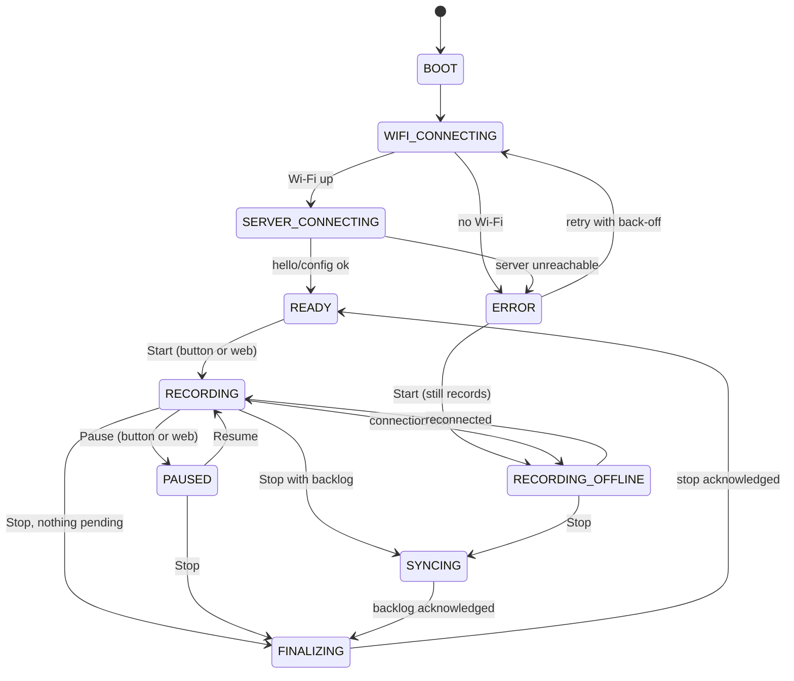
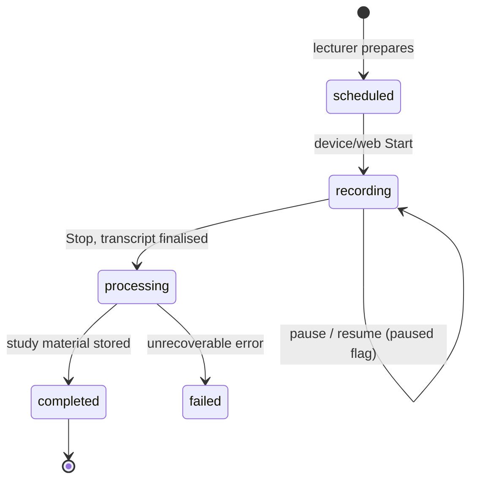
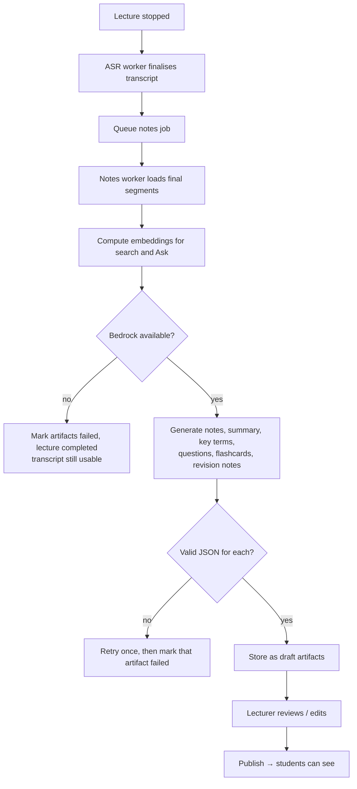
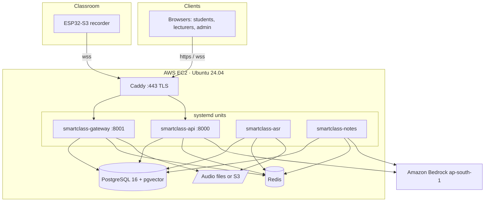

# UML Diagrams

All diagrams are Mermaid. They render on GitHub and in VS Code with a Mermaid preview extension. To get images for the report, paste each block into https://mermaid.live and export it as PNG or SVG.

## 1. Use case diagram

## 2. Class diagram (data model)

`ArtifactKind` is one of: summary, notes, key_terms, questions, flashcards, revision. `LectureStatus` is one of: scheduled, recording, processing, completed, failed.

## 3. Sequence diagram: live lecture

## 4. Sequence diagram: Wi-Fi outage and recovery

## 5. State machine: recorder device

## 6. Lecture lifecycle

## 7. Activity diagram: generating study material

## 8. Deployment diagram

